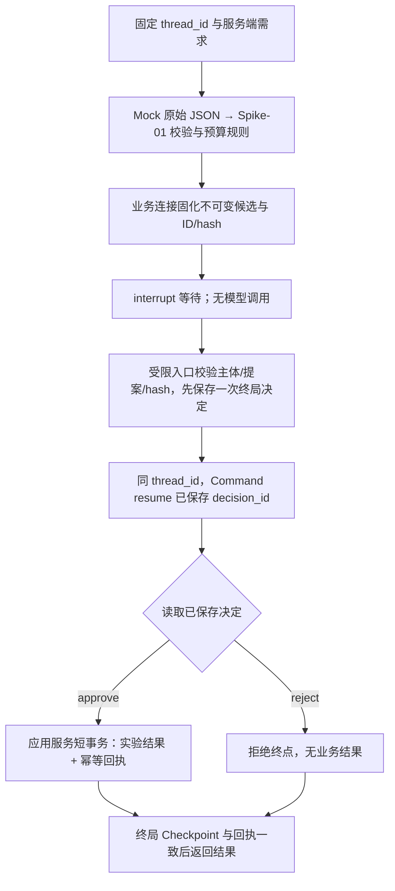

# Spike-02 实施与验证报告

- 日期：2026-11-09（Asia/Shanghai）。
- 依据：用户通过 Spike-01 报告 Review 后的明确授权；《Architecture Spike 技术实施方案 v0.2》第 6.2–6.4、8.2 节。
- 结论：**最小 PostgreSQL 持久化工作流、跨进程批准/拒绝、幂等及三个故障窗口已实际通过；停止于 Spike-02，等待 Review。**

## 1. 开始前检查

实际核对 Git：

```text
710b63d feat: validate Spike-01 structured travel drafts
1da6c25 chore: establish reproducible ENV-00 environment
git status --short：空（工作区干净）
```

原有 82 项 Spike-01 测试重跑结果：`82 passed in 0.09s`。
已逐一阅读 `contracts.py`、`rules.py`、`application.py`、`model_adapter.py`；本次均未修改。
新工作流复用 `TripRequirements`、`PlanDraftOutput`、`generate_draft()`、Mock 原始 JSON 解析链和 `evaluate_budget()`。
本次提案为完整草案的不可变候选封装，因此使用 PlanDraftOutput；不实现 ChangeProposalOutput 的正式草案修改流程。

重新连接 ENV-00 专用实例：PostgreSQL 16.15，`easytravel_env00_test` 数据库、`easytravel_env00` 用户、127.0.0.1:55432、Asia/Shanghai，异步只读 SELECT 与连接关闭通过。
使用既有 Python 3.12.16、LangGraph 1.2.20、checkpoint 4.3.1、checkpoint-postgres 3.2.0、psycopg 3.3.8；未新增依赖或修改 uv.lock。

## 2. 变更文件清单

以下路径相对于 `D:\Project\EasyTravel`，全部为新增文件：

| 文件 | 职责 |
|---|---|
| easytravel/spike02/__init__.py | 隔离 Spike-02 实验模块 |
| easytravel/spike02/database.py | 专用数据库目标白名单、连接配置、显式初始化 |
| easytravel/spike02/schema.sql | 专用实验业务表 DDL，不是正式业务迁移 |
| easytravel/spike02/repository.py | 固化提案、一次终局决定、请求去重、结果与回执短事务 |
| easytravel/spike02/workflow.py | 生成/固化、等待、批准业务入口和拒绝节点 |
| easytravel/spike02/service.py | 单执行器互斥、启动、查询、决定和显式继续 |
| easytravel/spike02/worker.py | 使用 SelectorEventLoop 的独立进程实验入口、JSON 握手和受控故障注入 |
| tests/spike02/conftest.py | 实际数据库初始化、带超时的子进程驱动 |
| tests/spike02/test_workflow.py | 25 项 PostgreSQL 集成/故障测试 |
| Docs/Spike-02_实际测试输出_2026-11-09.txt | 最终全量测试原始输出，含跨进程 PID、thread_id、结果与退出码 |
| Docs/Spike-02_实施与验证报告_2026-11-09.md | 本报告 |

## 3. 工作流与数据流



节点分别为 `generate → wait → apply/reject → END`。所有图调用使用 `durability="sync"`。
thread_id 由调用方稳定提供；proposal_id、operation_id 和 result_id 按固定图版本及 thread_id 稳定派生。
规范化 SHA256 绑定候选、需求、工作修订、主体、图版本及各 ID；等待前固化，恢复只读回固定候选。
生成节点重放时先查已有提案；等待节点不生成模型输出或新 ID。
Checkpoint 仅保存普通 JSON 可序列化状态，实验入口启用 `LANGGRAPH_STRICT_MSGPACK=true`。

本次批准的业务动作严格限定为 `accepted_candidate` 实验结果记录。
它不更新正式行程、不推进工作修订、不创建整体确认快照、不预订。
结果保留 `plan_confirmation=UNCONFIRMED`、`booked=false`、`readiness=NOT_ASSESSED`；未知预算仍为 INDETERMINATE。
已知超限候选在等待前拒绝，执行时再次复用预算规则检查。

## 4. 存储边界与连接生命周期

| 存储 | Schema/表 | 用途 |
|---|---|---|
| 官方 AsyncPostgresSaver | spike02_checkpoint：checkpoint_migrations、checkpoints、checkpoint_blobs、checkpoint_writes | 图状态、待执行节点、中断与恢复写入 |
| 实验业务连接 | spike02_business.proposals | 不可变候选、服务端需求、基础工作修订、ID/hash |
| 同上 | decisions | 每个提案至多一次终局 approve/reject |
| 同上 | decision_requests | request_id 与请求哈希/决定绑定；允许同内容重试 |
| 同上 | results、receipts | 实验业务结果及稳定操作回执，同一短事务提交 |

`initialize()` 显式创建两个任务专属 Schema 和业务表，然后等待官方 `saver.setup()` 完成。
实际官方迁移最高版本为 9；该数字是已安装 saver 的迁移版本，不是应用版本。
只在初始化命令或测试 session fixture 中 setup，不在每个决定请求中 setup。
`AsyncPostgresSaver.from_conn_string()` 上下文覆盖构图、执行、查询和恢复；业务连接独立，不与 Checkpoint 拼成同一事务。
使用单连接路径，无连接池。正常子进程输出 `connections_closed=true`；测试后实际查询其他 `easytravel-spike02` 活动连接数为 0。

数据库白名单检查数据库、账号、host、hostaddr、端口和 service，另查询实际连接身份；不接受其他业务库。
本次新表均位于两个 Spike-02 Schema，public 无业务表；未删除已有数据、容器或数据卷。
重复执行使用新 UUID thread，保留实验结果和故障样本，不自动清理历史数据。

## 5. 决定、幂等与恢复规则

- 固定演示主体为 `demo_owner`。错误主体、提案 ID、候选哈希在恢复前拒绝，不记录决定或结果。
- 决定先提交再 resume；同提案相反决定报冲突。同 request_id 换候选或决定报冲突；同内容重发返回既有结果。
- 业务节点先检查已保存批准及回执。同 operation_id、同请求哈希返回原 result_id；哈希不同明确报冲突。
- 结果插入与回执插入同事务。提交前失败全部回滚；提交后节点重放命中回执，不重复插入结果。
- 图等待且无决定时只返回待确认；已有决定时发送其 decision_id 恢复中断。
- 决定已消费、Checkpoint 待执行 apply 时用 `ainvoke(None)` 继续，不重复发送 resume；已结束则返回既有回执。
- 无 Checkpoint、版本/候选不匹配时明确报错，不新建或重新生成提案。
- 仅保存决定不等于成功；仅存在业务回执也不直接把待执行图标记成功。业务已提交而图待完成时报告 `recoverable` 和 `business_committed=true`。
- 数据库连接或 Checkpoint 写入异常向调用方抛出，不返回伪造成功。CLI 只输出错误类型/受控代码，不打印 DSN 或原始异常。

## 6. 实际测试命令与输出

项目根目录 PowerShell：

```powershell
$env:UV_CACHE_DIR = Join-Path $PWD '.cache/uv'
$env:UV_PYTHON_INSTALL_DIR = Join-Path $PWD '.tools/python'
$env:PYTHONUTF8 = '1'

# 首次/受控初始化；已有实验数据不会被清空
.tools/uv/uv.exe run --frozen --offline --no-sync --env-file .env python -m easytravel.spike02.worker init

# 包含原有 Spike-01 与新增 Spike-02 的实际全量测试
.tools/uv/uv.exe run --frozen --offline --no-sync --env-file .env python -m pytest -q -s > .cache/spike02-final-tests.txt 2>&1

.tools/uv/uv.exe lock --check --offline
.tools/uv/uv.exe pip check
git diff --check
```

初始化实际输出含 `event=initialized`。最终测试结果和完整子进程输出见同目录《Spike-02_实际测试输出_2026-11-09.txt》。

```text
107 passed in 20.18s
```

全部测试退出码为 0；故障注入子进程的 75 是测试明确要求的进程退出码，父测试随后核对数据库并执行恢复。
锁文件检查 `Resolved 55 packages`；依赖检查 `Checked 53 packages`、`All installed packages are compatible`；空白检查通过。

| 验证项 | 测试数 | 实际结果 |
|---|---:|---|
| Spike-01 原有全部测试 | 82 | 通过，无回归 |
| 单进程批准/拒绝，各再重复请求 10 次 | 2 | 通过，分别为 1/0 条结果与回执 |
| 错误主体/提案/hash | 3 | 通过，决定/结果均不增加 |
| 相反终局决定、同请求换内容 | 2 | 通过，原决定保留 |
| 请求键跨提案重用 | 1 | 通过，第二提案仍待确认 |
| 缺失 Checkpoint 查询/继续 | 2 | 通过，明确失败且不调用模型 |
| 伪造底层 resume | 1 | 通过，拒绝、无业务结果，污染状态明确阻断 |
| 事务中途异常及重连继续 | 1 | 通过，回滚后仅执行一次 |
| 业务连接丢失、Checkpoint 连接丢失 | 2 | 通过，未记录决定或成功结果 |
| 已知超限候选 | 1 | 通过，不进入等待 |
| 非专用库连接目标 | 1 | 通过，连接前拒绝 |
| 跨进程批准/拒绝及重发 | 2 | 通过，无恢复时模型调用 |
| 三个进程故障窗口（决定窗口另含拒绝） | 4 | 通过，退出后新进程可继续 |
| 实际 saver.aput 写入异常 | 1 | 通过，调用抛异常，业务回执保留并可继续 |
| 已有操作回执哈希冲突 | 1 | 通过，拒绝错误内容；测试篡改事务回滚 |
| 未知预算批准后的状态分离 | 1 | 通过，仍 INDETERMINATE/UNCONFIRMED/未预订/NOT_ASSESSED |
| **合计** | **107** | **通过；失败 0，跳过 0** |

开发中的初始失败与处理：非法 resume 的测试起初预期 recoverable，实际运行时保留中断和错误；现明确标为 inconsistent 并阻止追加决定/自动继续。
Checkpoint 写入故障注入起初补丁未命中运行时缓存的 saver allowlist 副本，导致测试未触发异常；改为对 saver 类的实际 aput 路径注入后，断言调用确实抛异常及数据库回执可恢复。
以上初始失败未计入最终通过；最终全量结果以随附原始输出为准。

## 7. 跨进程验证证据

完整证据包含每个进程的 PID、稳定 thread_id、候选 hash、proposal_id、result_id、状态、model_calls、连接关闭标记和退出码。
测试使用同步 `subprocess.run` 有界等待子进程完全退出后再启动下一进程，不依赖固定 sleep 或共享内存。
进程 A 正常暂停后退出；故障窗口中使用 `os._exit(75)` 在准确代码位置直接退出，跳过 Python 清理与节点返回。
恢复进程重建 saver、图和业务连接，Mock 不提供任何响应；如果恢复时重新生成模型输出，测试就会失败。
每条跨进程链只有最初生成的 `model_calls=1`，其余查询、决定、继续和重复请求均为 0。

最终运行的具体 PID/thread 证据在原始输出中，可按 `action`、`point` 和 `thread_id` 逐项核对。

| 场景 | thread_id（省略共同前缀 s02-） | 生成进程 PID | 强制退出进程 PID | 最终恢复进程 PID | 终局 |
|---|---|---:|---:|---:|---|
| 跨进程批准 | fef506ee17ee4503ba7b510670f1b1c1 | 25316 | — | 14860 | approved |
| 跨进程拒绝 | 58074cf89f8a457eb8ffab03cabb762a | 10372 | — | 25300 | rejected |
| 决定保存后退出，批准 | 9390ed630aa049f3989ec3bff8e2ce28 | 24784 | 6764 | 25476 | approved |
| 决定保存后退出，拒绝 | 3900d8fc2b7e4c84b7e827f03fc61aee | 11732 | 25532 | 22188 | rejected |
| 业务提交前退出 | 244940d16a4c45a1be01710583a88f62 | 23368 | 3948 | 12724 | approved |
| 业务提交后、节点返回前退出 | 67ff9154dcf94108b88af0f370496ced | 24808 | 1452 | 24944 | approved |

数据库断言独立核对 results/receipts/decisions 条数：批准终局为 1/1/1，拒绝为 0/0/1。
提交前退出时结果和回执为 0/0；提交后退出时已为 1/1，图仍报告 recoverable，后续继续不增加条数。

## 8. 已知问题、未执行及能力边界

没有未解决的验收阻塞。所有要求的实际 PostgreSQL 路径均执行，数据库不可用会使测试失败，不跳过或退回内存 saver。
异常样本只证明可检测和规定入口内的恢复，不是任意 Checkpoint 损坏修复器：绕过服务直接注入非法 Command 可能持久保留错误恢复值。
这种等待节点错误被标为 inconsistent，`decide/continue_run` 抛 `checkpoint_requires_review`，不自动覆盖恢复值或重建提案；需要人工检查，本轮不实现其修复流程。

运行约束为一个服务实例/单执行器，入口内 asyncio.Lock 串行化。跨进程实验严格前一进程结束后再启动下一进程。
唯一约束和请求哈希不等于多 worker 调度安全；未测试并发竞争、租约、图升级兼容、后台扫描恢复、连接池或灾备。
模拟过连接关闭及 saver 写入失败，未停止 PostgreSQL daemon、注入网络分区或做数据库重启灾难实验。
无真实模型、供应商 SDK、旅游研究或真实价格验证；固定主体检查不是生产身份认证。
预算与证据逻辑沿用 Spike-01；此实验没有新的真实证据来源，不能因为持久化成功而提升可信度。

未实现正式工作草案修改、酒店保护、确认快照、正式版本推进及相关事务；它们仍属于 Spike-03。
未新增 FastAPI/Vue 页面、多 Agent、RAG、Redis、Celery、正式数据库迁移或非必要组件。
Checkpoint 与业务事务仍独立，只以持久决定和幂等回执协调；不宣称模型/节点调用 exactly-once。

## 9. Git 交付

本次以独立本地提交 `feat: persist Spike-02 approval workflow and recovery` 交付；实际哈希与最终工作区状态在交付消息中给出，可用 `git log -2 --oneline` 核对。
提交前扫描候选文件，排除本地真实密码、私钥/token、带真实密码的 DSN、.env、.local、虚拟环境、运行时及缓存。
未修改全局 Git 配置，未创建远程仓库或推送；未触及 Spike-01 已确认代码、依赖锁和历史文档。

官方机制参考：[Interrupts](https://docs.langchain.com/oss/python/langgraph/interrupts)、[Persistence](https://docs.langchain.com/oss/python/langgraph/persistence)；实现行为以本机锁定版本源码及本报告实际测试为准。

**Spike-02 到此停止，等待下一轮 Review；未开始 Spike-03。**
