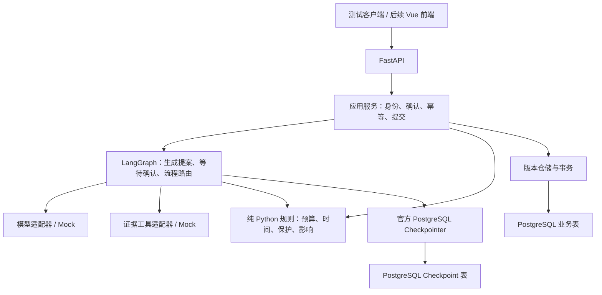

# 旅游规划 Agent Architecture Spike 技术实施方案

- 版本：v0.1
- 日期：2026-11-08
- 状态：待 Review，尚未进入编码阶段
- 范围：Spike-01 结构化输出、Spike-02 LangGraph 中断与恢复、Spike-03 安全修改

本方案用于评审三个技术验证，不代表正式开发已启动。方案编制时仅进行了只读检查和官方文档查阅，没有安装依赖或修改代码。本 Markdown 文件按用户后续要求保存。

建议采用 **FastAPI 模块化单体 + 单一 LangGraph 工作流 + Pydantic v2 + PostgreSQL**。重点验证结构化输出、持久化恢复和安全修改三个边界，通过后再冻结依赖版本、开展正式工程骨架与前端开发。

## 1. 当前仓库与环境分析

### 1.1 仓库现状

当前目录为 `D:\Project\EasyTravel`，包含：

- [旅游规划Agent_产品立项与MVP规划_v0.1.docx](./旅游规划Agent_产品立项与MVP规划_v0.1.docx)
- [旅游规划Agent_技术选型与架构评审_v0.1.docx](./旅游规划Agent_技术选型与架构评审_v0.1.docx)

**目录并非完全为空，但代码项目尚未建立，应按照全新项目设计。**

检查未发现源码、测试、依赖清单、项目配置或适用的 `AGENTS.md`；当前目录未初始化 Git。上述结论为方案编制时的检查结果。

已有文档提供了以下设计基线：

| 基线 | 对本方案的影响 |
|---|---|
| 国内 1–5 天短途旅行 | Spike 使用单目的地、人民币、明确日期的样例 |
| 整体认可不等于确认每个项目 | 整体确认与酒店等项目确认分别记录 |
| 规划确认不等于已预订 | 不由确认操作生成预订状态 |
| 已确认项目不得擅自替换 | 修改保护由 Python 规则执行 |
| 超出预算硬上限必须先确认 | 修改提案不能自行提高硬上限 |
| 修改失败保留旧版本 | 候选计算与正式提交分离 |
| M0 使用 Mock，不代表真实研究能力 | 测试数据始终标注为合成数据 |

### 1.2 环境检查结果

| 项目 | 实际检查结果 | 后续影响 |
|---|---|---|
| 操作系统与终端 | Windows、PowerShell | 子进程测试需兼容 Windows |
| Git | 命令可用，当前目录不是 Git 仓库 | 编码阶段再初始化 |
| Node.js | `v24.14.0` | 已有前端运行时，尚未验证项目兼容性 |
| npm | `11.9.0` | 可用于后续前端依赖管理 |
| Python | 当前命令指向 WindowsApps，启动失败；`py` 不可用 | 尚未确认可用 Python 运行时 |
| Python 依赖 | 无法通过当前 Python 检查 | 不能宣称 FastAPI、Pydantic、LangGraph 已安装 |
| uv、psql | 当前 PATH 未找到 | 不等于机器上绝对未安装 |
| Docker | CLI `29.7.2` 可用，daemon 连接失败；配置读取受限 | 尚不能确认容器环境可用 |
| PostgreSQL | 未建立连接验证 | 编码阶段需要可连接的测试实例 |

建议编码阶段采用 Python 3.12 作为初始兼容性基线，再验证所选依赖组合并锁定版本。本阶段不进行环境修复或安装。

## 2. 最小技术架构及选择理由

### 2.1 架构边界



**Agent 只能生成草案和修改提案，不持有正式行程写入能力。** 图中的提交步骤也只能调用受约束的应用服务，由应用服务重新校验并执行事务。

### 2.2 技术选择

| 层级 | 推荐 | 理由与本阶段范围 |
|---|---|---|
| 前端 | 保留 Vue 3 + TypeScript + Vite | 三个 Spike 不需要开发页面；用 API 和测试驱动验证 |
| API | FastAPI | 提供最小创建、状态查询、确认接口 |
| 工作流 | LangGraph `StateGraph` | 显式验证中断、恢复和拒绝分支 |
| 契约 | Pydantic v2 | 统一验证外部输入、模型输出和持久化快照 |
| 规则 | 普通 Python 函数与服务 | 易测试，不依赖模型或图运行时 |
| 数据库 | PostgreSQL | 同时验证官方 checkpoint 实现和业务事务 |
| 数据访问 | SQLAlchemy 2 + psycopg，Alembic 管业务迁移 | 明确事务、唯一约束和版本竞争控制 |
| 测试 | Pytest；异步与 API 测试按需配套 | Mock 模型作为默认测试路径 |

采用 PostgreSQL 的主要原因是与本次 checkpoint 验证方向一致，而不是 MySQL 无法满足业务事务。

本阶段不引入多 Agent、RAG、Redis、Celery、向量数据库、地图或真实酒店/铁路接口，也不开发通用任务平台。

### 2.3 必须保持的系统不变量

1. 正式行程只能通过确定性应用服务提交。
2. 模型输出的总价、确认状态、可信状态、权限等级均不具备权威性。
3. 每次成功修改创建一个新版本，旧快照不被覆盖。
4. 提交失败时，当前版本指针与正式快照不变。
5. 同一操作重复执行，最多产生一个业务结果。
6. 用户同意的是特定版本上的特定提案，不能被挪用于新提案。
7. 工作流 checkpoint 记录执行进度，业务版本表记录正式行程；两者职责不同。

## 3. 推荐目录结构和模块职责

以下为未来建议结构，尚未创建。

```text
EasyTravel/
├─ Docs/                         # 现有规划文档
├─ backend/
│  ├─ pyproject.toml
│  ├─ src/easytravel/
│  │  ├─ api/
│  │  │  ├─ routes.py            # 最小 HTTP 接口
│  │  │  └─ dependencies.py      # 身份、连接与服务装配
│  │  ├─ contracts/
│  │  │  ├─ trip.py
│  │  │  ├─ plan.py
│  │  │  ├─ evidence.py
│  │  │  ├─ proposal.py
│  │  │  └─ workflow.py
│  │  ├─ domain/
│  │  │  ├─ budget.py            # 金额、费用口径、预算判断
│  │  │  ├─ schedule.py          # 时间与移动约束
│  │  │  ├─ protection.py        # 已确认项目保护
│  │  │  └─ impact.py            # 修改影响与权限判断
│  │  ├─ application/
│  │  │  ├─ planning.py          # 草案与提案编排
│  │  │  ├─ confirmation.py      # 确认、拒绝、重复请求
│  │  │  ├─ commit.py            # 原子版本提交
│  │  │  └─ recovery.py          # 崩溃后状态核对
│  │  ├─ agent/
│  │  │  ├─ state.py
│  │  │  ├─ graph.py
│  │  │  └─ nodes.py
│  │  └─ infrastructure/
│  │     ├─ models.py            # 模型适配器及 Mock
│  │     ├─ evidence.py          # 证据适配器及 Mock
│  │     ├─ persistence.py       # ORM、仓储、事务
│  │     └─ checkpointer.py      # 官方 saver 的生命周期
│  ├─ migrations/
│  └─ tests/
│     ├─ unit/
│     ├─ integration/
│     ├─ process/
│     └─ fixtures/
└─ frontend/                     # 后续阶段再建立
```

依赖方向为：API/Agent → 应用服务 → 领域规则；基础设施实现模型、证据和仓储接口。领域规则不导入 LangGraph、FastAPI 或模型 SDK。

## 4. Pydantic 核心数据模型设计

### 4.1 分开设计输入与权威状态

不让 LLM 输出完整数据库实体。至少区分：

| 模型类别 | 允许包含 | 禁止赋予模型的能力 |
|---|---|---|
| `PlanDraftOutput` | 日期安排、项目候选、证据引用、未核实估算 | 设置正式版本、用户确认、已核实价格 |
| `ChangeProposalOutput` | 目标项目、允许的修改操作、理由 | 设置最终权限等级、批准状态、提交状态 |
| 领域与持久化模型 | 服务端生成的 ID、确认记录、可信状态、版本信息 | 必须由业务服务构建 |

JSON Schema 只保证形状约束的一部分；格式正确不代表事实真实，也不代表修改合法。模型适配器可使用 `with_structured_output`，但输出仍须经过本地验证。参考：[LangChain 模型结构化输出](https://docs.langchain.com/oss/python/langchain/models#structured-output)。

### 4.2 核心模型

| 模型 | 建议主要字段 | 核心约束 |
|---|---|---|
| `TripRequirements` | 出发地、目的地、日期、人数、时区、目标预算、硬上限、偏好 | 结束日期合法；人数为正；目标预算不高于硬上限 |
| `Money` | `amount_minor`、`currency` | 金额使用最小货币单位整数；本阶段仅 CNY |
| `EvidenceRecord` | 来源、获取时间、适用日期、人数/房型等条件、来源类型、状态 | 由证据适配器建立；模型不能自封已核实 |
| `PriceEstimate` | 点估算或区间、估算依据 | 始终标记估算，不冒充报价 |
| `PriceQuote` | 金额、计价单位、适用条件、证据 ID、有效期 | 由可信工具记录支持；引用和适用条件均须匹配 |
| `PlanItem` | 稳定项目 ID、类型、资源 ID、起止时间、地点、价格引用、依赖 | ID 唯一；时间合法；资源使用稳定 ID |
| `PlanSnapshot` | 旅行 ID、需求修订号、项目、假设、未知项、schema 版本 | 引用完整，能够完整重新验证 |
| `BudgetSummary` | 已核实小计、估算区间、未知项、检查金额、判断结果 | 只由预算函数计算 |
| `ConfirmationRecord` | 主体、确认层级、项目 ID、范围摘要、内容哈希、决策时间 | 整体认可不自动确认酒店 |
| `ChangeProposal` | 基础版本、操作列表、理由、候选哈希、影响报告 | 不接受任意字段路径修改 |
| `ApprovalDecision` | 请求 ID、批准/拒绝、提案哈希、基础版本、授权范围 | 身份从服务端上下文取得 |
| `PlanVersion` | 版本 ID、父版本 ID、快照、提交操作 ID、时间 | 成功提交后不可覆盖 |
| `CommitReceipt` | 操作 ID、请求哈希、结果版本、结果状态 | 重放时返回既有结果 |

价格可信度、用户确认、预订状态分别建模，不能互相推导。

### 4.3 金额和预算口径

本阶段建议统一：

- 对外人民币金额进入适配器后转换为整数分；禁止 `float` 参与财务加总。
- 费用明确 `per_person`、`per_room_night`、`per_booking` 等单位和数量。
- 每笔费用有唯一费用 ID，避免酒店在住宿项和每日安排中重复计费。
- 酒店按房间数 × 晚数，交通按乘客数 × 对应单价。
- 预算摘要包含未覆盖类别，例如餐饮、接驳或税费未知。

预算结果至少区分：

| 状态 | 含义 | 提交策略 |
|---|---|---|
| `WITHIN_EVALUATED_BUDGET` | 覆盖项完整，按既定估算上界未超限 | 可继续其他检查，不承诺真实最终花费 |
| `OVER_LIMIT` | 检查金额超过硬上限 | 阻止正式提交 |
| `INDETERMINATE` | 存在未覆盖费用或无法形成上界 | 保留候选草案，不标记预算通过 |

**未知金额不能按零元计算后宣布预算合规。**

示例验收夹具：酒店 ¥300 × 2 晚、交通 ¥120 × 2 人、活动 ¥80 × 2 人、餐饮预留 ¥240、接驳 ¥100，总计应为 **¥1,340**。全部属于合成测试数据。

### 4.4 时间与保护规则

时间使用带时区的日期时间；区间采用左闭右开语义。检查：

- 活动是否超出旅行日期。
- 相邻活动是否重叠。
- 是否预留声明的移动时间。
- 到达目的地后才能参加活动，离开前必须结束。
- 酒店入住/退房窗口与住宿日期是否一致。
- 缺少移动时间或营业条件时，返回未验证状态，不宣称真实可执行。

住宿区间与活动允许并存，不能把整晚住宿简单作为占用全天的活动。

已确认酒店保护至少覆盖资源 ID、房型、入住/退房日期、房间数。仅比较酒店名称不足以保护确认内容。

### 4.5 校验配置

建议：

- `extra="forbid"`，阻止模型混入 `approved`、`verified`、`version` 等字段。
- 金额、数量、布尔值使用明确严格类型；JSON 日期等使用受控解析。
- 限制项目数量、文本长度和操作数量。
- 使用类型区分的操作模型，如新增活动、移动活动、替换酒店；不开放通用 JSON Patch。
- 候选构建后重新执行完整验证，不能依赖 `model_copy(update=...)`。

Pydantic 明确说明复制更新不会自动验证更新数据；严格模式对 JSON 与 Python 输入也存在差异，应固定入口并测试。参考：[Pydantic Models](https://docs.pydantic.dev/latest/concepts/models/)、[Strict Mode](https://docs.pydantic.dev/latest/concepts/strict_mode/)。

## 5. LangGraph 持久化与恢复方案

### 5.1 最小工作流

```text
读取需求/基础版本
→ Mock 研究与模型生成
→ 结构验证
→ 业务检查
→ 固化提案及摘要
→ 等待确认 interrupt
    ├─ 拒绝 → 记录拒绝 → 结束
    └─ 批准 → 重新校验 → 应用服务事务提交 → 结束
```

本阶段单线程中只允许一个待确认提案。拒绝后不自动重新生成，避免拒绝变成隐式同意或无限重试。

`interrupt` 需要 checkpointer；恢复使用相同 `thread_id` 和 `Command(resume=...)`。恢复会从节点开头重新执行，不能用宽泛异常捕获吞掉中断信号。参考：[LangGraph Interrupts](https://docs.langchain.com/oss/python/langgraph/interrupts)。

因此：

- 模型生成、提案固化与等待确认分开节点。
- 等待节点保持简单，不在中断前重新生成提案。
- 所有持久化副作用均设计为可重放。
- 不在恢复过程中重新生成审批 ID 或操作 ID。

### 5.2 持久化选择

推荐使用官方 `langgraph-checkpoint-postgres` 中的 `AsyncPostgresSaver`，配合 FastAPI 异步生命周期管理连接。首次使用需显式执行 saver 的 `setup()`；业务表迁移单独管理。参考：[AsyncPostgresSaver setup](https://reference.langchain.com/python/langgraph.checkpoint.postgres/aio/AsyncPostgresSaver/setup)。

使用同一 PostgreSQL 实例，但区分：

- **Checkpoint 表**：由 LangGraph 管理，存执行状态。
- **业务表**：旅行、需求修订、不可变版本、提案、确认请求、决定记录和提交回执。

Graph state 尽量保存 ID、提案哈希、流程状态和 schema 版本，避免长期复制整个正式数据库实体。

验证时采用同步持久化模式，减少步骤间 checkpoint 未落盘的窗口；这仍不能让业务提交和 checkpoint 自动成为同一事务。参考：[LangGraph Checkpointers](https://docs.langchain.com/oss/python/langgraph/checkpointers)。

### 5.3 确认处理与重复请求

确认请求绑定：

`owner_id + thread_id + approval_request_id + proposal_hash + base_version_id + requirements_revision`

处理顺序：

1. 验证当前主体是否拥有该旅行和确认权限。
2. 根据幂等键查询已接收请求。
3. 同键同内容返回既有结果；同键不同内容返回冲突。
4. 验证当前待确认提案、基础版本及需求修订。
5. 原子接收批准或拒绝决定。
6. 向对应中断传递决定记录 ID。
7. 恢复后读取服务端决定记录并重新校验。

不能把客户端传来的 `actor_id` 或模型生成的“用户已批准”当作授权。

同一确认请求只允许一个终局决定。批准与拒绝并发时，只能有一个成功。

### 5.4 并发与事务

建议使用 PostgreSQL 锁和唯一约束：

- 每个 thread 的图执行采用数据库会话级 advisory lock，避免跨进程同时恢复；执行完可靠释放。
- 不在模型调用期间持有长时间业务行事务。
- 提交事务锁定旅行当前版本行，检查基础版本仍为当前版本。
- 在同一事务内写入新版本、推进当前指针、写入提交回执。
- 对提交操作 ID 建唯一约束。

即使不同 thread 修改同一旅行，旧基础版本也必须被拒绝，不能覆盖另一次成功修改。

### 5.5 崩溃恢复

Checkpoint 与业务事务分开，必须显式验证以下窗口：

| 故障位置 | 恢复行为 |
|---|---|
| 等待确认已持久化，进程退出 | 新进程查询同一 thread，仍显示待确认 |
| 决定已落业务库，尚未恢复图 | 根据决定记录恢复对应中断 |
| 图已消费决定，后续执行失败 | 根据 checkpoint 继续执行，不盲目再次投递确认 |
| 新版本已提交，完成 checkpoint 未落盘 | 提交节点重放时查询回执，返回既有版本 |
| 事务写入中途失败 | 整体回滚，当前版本不变 |

恢复服务必须核对最新 checkpoint、待执行节点、决定记录和提交回执，区分“待投递确认”与“决定已消费、执行未完成”。

本阶段通过显式恢复调用或原请求重试触发，不引入后台队列。**保证业务结果幂等，不宣称模型调用或节点执行 exactly-once。**

## 6. 三个 Spike 的任务、测试与验收

### 6.1 Spike-01 结构化输出

目标：验证不可信模型输出能够被转换为合法草案，并正确处理非法数据、价格可信度和预算。

| 任务 | 开发内容 | 自动化测试与验收标准 |
|---|---|---|
| S01-01 数据契约 | 需求、项目、价格、证据、草案和预算模型 | 合法样例通过；缺字段、负金额、非法枚举、重复 ID、未知引用全部拒绝 |
| S01-02 模型适配器 | 统一生成接口；Mock 返回原始响应；真实适配器可替换 | 无 API Key 时完成全部默认测试；Mock 也必须经过真实解析与校验链 |
| S01-03 输出错误处理 | 区分格式错误、验证失败、模型拒绝、超时和限流 | 截断 JSON、Markdown 包裹、空响应、拒绝响应均得到明确结果 |
| S01-04 有限修复 | 格式/结构错误最多修复一次 | 连续失败后停止；调用次数有上限；不返回半合法草案 |
| S01-05 可信价格构建 | 模型仅引用已有证据；未知价格保留估算/未知 | 伪造证据 ID、错日期报价、Mock 来源、模型自报已核实均不能成为真实已核实价格 |
| S01-06 确定性预算 | 单位展开、去重、分类汇总、未知项处理 | 合成样例精确为 134000 分；恰好上限通过，多一分超限；未知不按零处理 |

补充约束：

- 模型输出总价不作为计算输入。
- 过期或适用条件不匹配的报价不参与已核实小计。
- 证据记录存在不等于来源真实可靠；Spike 只能验证证据链规则。
- 模型拒绝不进入无意义的结构修复循环。

**退出标准：** 无真实 API 可复现全部失败路径；不存在非法草案进入正式提交路径的情况。

### 6.2 Spike-02 LangGraph 中断与恢复

目标：证明等待、批准、拒绝、重启和重复请求能够形成一致结果。

| 任务 | 开发内容 | 自动化测试与验收标准 |
|---|---|---|
| S02-01 最小图 | 生成提案→等待→批准/拒绝 | 未确认前没有新正式版本；拒绝后结束且版本不变 |
| S02-02 PostgreSQL saver | 建立 checkpoint 表、连接与生命周期 | 销毁图实例后仍能读取状态；验收不能用内存 saver 替代 |
| S02-03 确认服务 | 主体检查、提案绑定、决定持久化 | 错用户、错 thread、错提案、过期版本不能恢复或提交 |
| S02-04 跨进程恢复 | 进程 A 中断，进程 B 重新建图并恢复 | A 完全退出；B 不共享任何内存；仍能批准和拒绝 |
| S02-05 幂等与并发 | 唯一决定、唯一提交、执行锁 | 同确认重复 10 次只产生一个结果；批准/拒绝竞争仅一方成功 |
| S02-06 崩溃窗口 | 持久决定和业务回执驱动恢复 | 决定落盘前后、业务提交前后强制退出，最终无重复版本、无丢失已提交结果 |

跨进程测试需使用 Pytest 启动独立子进程，并通过数据库状态或进程通信确定故障注入点，避免靠固定睡眠碰运气。

额外验收：

- 两个不同 thread 的状态互不串联。
- 同幂等键不同请求内容必须冲突。
- 旧审批不能批准新提案。
- API 返回等待前，应确认 checkpoint 已持久化。
- PostgreSQL 不可用时，持久化测试明确失败或报告未执行，不能宣称 Spike 通过。

**退出标准：** PostgreSQL 上真实跨进程恢复和关键故障注入全部通过。

### 6.3 Spike-03 安全修改

目标：证明提案经过规则和授权后才能生成新版本，任何失败均不污染原行程。

处理流程：

```text
加载基础版本
→ 应用允许的操作，构造独立候选
→ 完整模型验证
→ 计算实际差异与依赖影响
→ 检查确认保护、预算、时间与权限
→ 必要时等待用户批准
→ 提交前重新检查
→ 原子生成新版本
```

| 任务 | 开发内容 | 自动化测试与验收标准 |
|---|---|---|
| S03-01 类型化修改 | 仅接受明确的增删改操作 | 任意字段路径、修改版本号、写确认状态、伪造证据等操作全部拒绝 |
| S03-02 候选隔离 | 从持久化快照构建独立候选 | 任何校验失败后，原对象、数据库快照、当前指针均不变 |
| S03-03 酒店保护 | 比较资源、房型、日期、房间数与依赖变化 | 未授权更换酒店、删后重建、同名不同 ID、改入住日期全部拦截 |
| S03-04 预算与时间 | 重算全案成本及受影响时间 | 超硬上限、重叠、移动时间不足、错过到达/离开窗口均不能提交 |
| S03-05 权限判定 | Python 从真实差异计算 L1/L2/L3 | 模型自称 L1 无效；整体认可不锁酒店；批准某酒店不授权其他项目 |
| S03-06 原子提交 | 不可变版本、当前指针、回执 | 成功仅新增一个版本；旧版不变；注入数据库错误后全部回滚 |
| S03-07 过期与竞争 | 基础版本、需求修订、提案哈希校验 | 基础版本被推进后拒绝旧提案；不同提案并发提交仅一个成功 |

建议第一轮权限策略：

- L1：未确认活动的轻微调整，通过全部规则后可自动提交并记录。
- L2：生成可审阅草案，不自动切换当前正式版本。
- L3：涉及已确认项目等重大变化，必须取得绑定提案的明确批准。
- 超硬上限：本阶段一律阻止；以后通过独立需求修订流程显式调整预算，再重新校验。不能用通用“批准修改”绕过上限。

酒店变更即使得到授权，也必须重检接驳、周边活动和预算。实质变化的新酒店不能直接继承旧酒店的确认记录。

**退出标准：** 所有失败路径保持原版本不变；授权且合法的修改恰好生成一个新版本。

## 7. 测试组织与整体验收标准

### 7.1 测试层次

| 层次 | 覆盖内容 | 外部依赖 |
|---|---|---|
| 单元测试 | 模型、预算、时间、保护、权限 | 无网络、无数据库 |
| 集成测试 | 仓储、事务、唯一约束、API、checkpoint | 测试 PostgreSQL |
| 进程测试 | 中断后重启、崩溃与重放 | 独立子进程 + 测试 PostgreSQL |
| 可选在线验证 | 某个真实模型的结构化协议兼容性 | API Key；单独标记，不作为默认门禁 |

持久化和事务验收必须针对 PostgreSQL，不能仅用 SQLite 或内存仓储代替。

### 7.2 公共测试夹具

建议使用同一套三天两晚合成旅行：

- 两位旅客，CNY，`Asia/Shanghai`。
- 明确目标预算与硬上限。
- 一家已确认酒店。
- 一组未确认活动。
- 有报价记录、估算、未知价格三类费用。
- 有到达时间、离开时间及显式移动时间。
- 所有研究数据标注 `mock`。

固定时钟、Mock 响应和 ID 生成入口，避免测试结果依赖当前日期或随机输出。

### 7.3 整体通过条件

三个 Spike 全部通过需要同时满足：

1. 默认测试无需真实模型 API。
2. 非法输出和伪造已核实价格无法进入正式版本。
3. 预算由 Python 精确计算，未知项不被隐去。
4. 重启后能够继续批准或拒绝原提案。
5. 重复和并发确认不产生重复提交。
6. 已确认酒店未经对应授权不能变化。
7. 修改失败不改变原快照或当前版本指针。
8. 成功修改创建新版本且保留旧版。
9. 业务提交后崩溃仍能返回同一结果。
10. 未执行的数据库或进程测试被明确披露。

不以单一覆盖率替代这些行为验收。

## 8. 关键风险与待决策问题

### 8.1 技术风险

| 风险 | 影响 | 应对 |
|---|---|---|
| Python 与数据库环境未就绪 | 无法运行验证 | 编码阶段先完成环境门禁 |
| 模型支持的 JSON Schema 子集不同 | 本地模型合法，供应商接口仍可能拒绝 | 输出模型保持简单，领域校验放本地 |
| 结构合法但事实错误 | 假价格获得可信外观 | 可信状态仅由工具证据和服务端规则建立 |
| 节点重放 | 重复模型调用或重复写入 | 固化提案、幂等键、提交回执 |
| checkpoint 与业务事务分离 | 已提交但工作流显示未完成 | 状态核对与故障注入验证 |
| 确认后内容变化 | 用户批准被挪用 | 绑定提案哈希、基础版本和需求修订 |
| 只保护酒店字段 | 日期或交通变化间接破坏住宿 | 校验实际差异及依赖影响 |
| 估算被当成最终价格 | 预算结论过强 | 分开显示核实、估算和未知项 |
| 工作流升级破坏恢复 | 旧 checkpoint 无法继续 | Spike 固定图结构并记录 schema/graph 版本 |
| 单纯 Mock 验证不足 | 无法证明真实研究或供应商兼容性 | 明确能力边界，后续单独验证 |

### 8.2 建议 Review 决策

| 问题 | 本方案推荐 |
|---|---|
| Spike 数据库 | PostgreSQL |
| Python 基线 | 3.12，编码时验证依赖后锁版本 |
| 金额与币种 | 整数分，仅 CNY |
| 未知费用 | 草案可保留，正式预算检查不通过 |
| 超硬上限 | 阻止提交；预算调整走独立需求修订 |
| 已确认酒店变化 | 绑定具体提案的明确授权 |
| L2 修改 | 只更新草案，审阅后提交 |
| 身份与权限 | 测试注入服务端主体，不开发完整登录系统 |
| 真实 API | 可选协议验证，不作为自动化门禁 |
| 前端 | 三个 Spike 后再开发 |

## 9. 建议开发顺序

| 顺序 | 内容 | 完成后获得的证据 |
|---|---|---|
| 0 | Review 本方案，明确预算、确认和数据库策略 | 规则口径可执行 |
| 1 | 准备 Python、PostgreSQL 和最小测试配置 | 环境可复现 |
| 2 | Spike-01：契约、非法输出、价格、预算 | 不可信输出能够被安全处理 |
| 3 | Spike-02：基础中断、批准、拒绝和重启 | 工作流能跨进程恢复 |
| 4 | Spike-03：候选隔离、保护、约束、版本事务 | 修改可安全提交 |
| 5 | 联合验证重复确认、并发和提交后崩溃 | checkpoint 与业务状态能够收敛 |
| 6 | 汇总测试结果和已知限制 | 决定是否冻结技术栈并进入 M0 工程开发 |

建议先在三个 Spike 共用一个最小后端包中验证，不建立三个独立应用。正式开发应以这些行为证据为起点，避免把未经验证的恢复和提交机制带入完整产品。

**当前停在 Review 阶段，待评审后再决定是否编码。**
