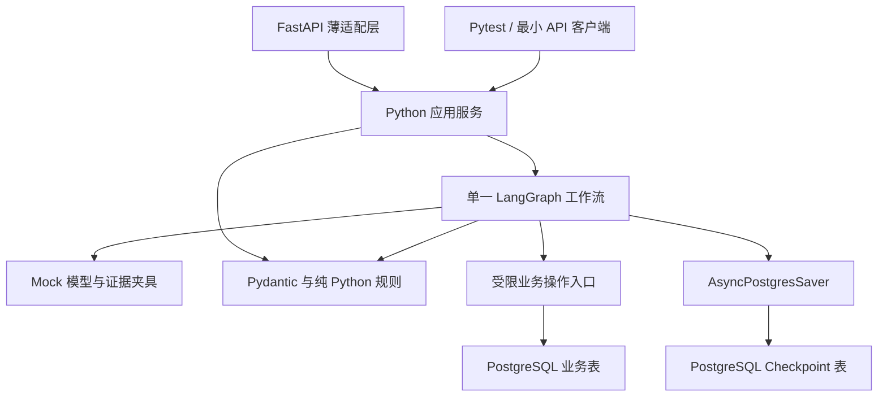

# 旅游规划 Agent Architecture Spike 技术实施方案

- 版本：v0.2
- 日期：2026-11-08
- 状态：根据第一轮 Review 修订，等待下一轮 Review，暂不批准编码
- 前版：[Architecture Spike 技术实施方案 v0.1](./旅游规划Agent_Architecture_Spike技术实施方案_v0.1.md)
- 本次变更范围：仅新增本技术方案 Markdown；不编写业务代码、不安装依赖、不初始化 Git 或数据库、不修改其他项目文件。

## 1. 评审结论与设计边界

保留 FastAPI 模块化单体、Pydantic v2、单一 LangGraph 工作流和 PostgreSQL 候选方向。Agent 只输出草案或修改提案；预算、授权、状态转换和版本操作均由确定性 Python 逻辑执行。Checkpoint 与业务快照分别持久化。

本阶段的交付证据是可重复运行的技术实验和断言，不是完整 MVP 后端。必须证明结构化输出失败可控、跨进程恢复可行、业务操作幂等，以及已确认项目和历史快照受到保护。前端、真实旅游研究和完整身份系统不属于本阶段。

本版修正两项产品语义：

1. **整体规划可以在预算核实状态为 INDETERMINATE 时被用户明确确认。** 必须保留并展示未知价格，不能因此宣布预算已核实或出行准备就绪。
2. **工作草案更新与整体规划确认是不同操作。** L1/L2 可以按权限更新工作草案；最近已确认快照只会由用户对具体工作修订的整体确认推进。

已知超出硬上限的修改不能生效。提高上限必须单独获得明确授权并修订需求，不能通过通用提案审批绕过。该完整需求修订流程留到正式开发，本阶段验证拒绝边界。

### 1.1 仓库与环境基线

v0.1 只读检查发现：项目原有两份 Word 规划文档，无源码、依赖清单或测试，未初始化 Git；随后按要求新增 v0.1 Markdown。因此应按全新代码项目设计，而非空文档目录。

| 环境项 | v0.1 检查结果 | 本版处理 |
|---|---|---|
| Python | WindowsApps 命令启动失败，`py` 不可用 | ENV-00 重新确认真实解释器 |
| Docker | CLI 29.7.2 可用，daemon 连接失败，配置访问受限 | Docker 是数据库准备选项，不是必须项 |
| PostgreSQL | 未连接验证；PATH 未找到 psql | ENV-00 准备专用测试实例并验证 |
| Git | 命令可用，目录未初始化 | 本轮不初始化 |
| Node/npm | 24.14.0 / 11.9.0 | 保留，Spike 不开发前端 |

以上是历史观测，不代表本轮重新验证环境已可用。本轮核对包元数据的 PowerShell HTTPS 请求出现认证/TLS 失败；已通过浏览工具查阅官方来源，未更改证书或网络设置。

## 2. 修订后的最小架构



模型只看输入快照、证据和允许的操作 schema，不获得连接、仓储或任意数据库工具。图的业务操作节点调用同一应用服务，不能自行写行程。

### 2.1 Spike 实现取舍

| 组件 | 最小实现 |
|---|---|
| FastAPI | 一层启动、查询、决定/恢复薄接口；不做通用旅行 CRUD |
| 身份上下文 | 测试注入固定 `demo_owner`；决策主体由服务端传入，不接受模型自报授权 |
| 工作流 | 单进程、单执行器；每个 thread 同时最多一个待决定提案 |
| 模型/证据 | 固定夹具经真实解析与规则链；默认不需要模型 Key |
| 业务数据访问 | 直接使用 psycopg 参数化 SQL 与短事务；暂不引入 ORM/Alembic |
| Checkpoint | 官方 AsyncPostgresSaver，独立连接 |
| 业务快照 | 工作草案修订 + 不可变已确认快照 + 幂等回执 |
| 并发控制 | 单执行器约束、基础修订条件更新、数据库唯一约束；不加 Advisory Lock |
| 恢复 | 测试驱动的显式继续操作，不开发通用恢复服务 |

后续最小模块可收敛为 contracts、rules、application、workflow、persistence、api 和 tests；无需实现 v0.1 的完整分层文件树。正式开发时再按模块复杂度拆分。

## 3. 业务状态与版本语义

### 3.1 三个独立状态维度

| 维度 | 建议表示 | 含义 |
|---|---|---|
| 规划确认 | `UNCONFIRMED`、`CONFIRMED`、`HAS_UNCONFIRMED_CHANGES` | 当前工作内容是否有对应整体确认快照 |
| 预算核实 | `VERIFIED`、`ESTIMATED`、`INDETERMINATE` | 费用证据与覆盖程度；不等价于是否超限 |
| 出行准备 | `NOT_ASSESSED`、`NOT_READY`、`READY` | 住宿、主要交通、阻塞风险和预订等准备条件 |

预算另有独立约束结果 `WITHIN_LIMIT`、`OVER_LIMIT`、`UNDETERMINED`。预算完全核实仍可能超限；估算或未知也可能已有确定超限部分，不能混成单一枚举。

Spike 不实现完整 READY 判定引擎，默认 NOT_ASSESSED；预算为 INDETERMINATE 时禁止输出 READY。真实准备状态需要后续阶段验证。

**整体确认不自动确认每个酒店/交通项目，也不意味着已预订、价格已核实或 READY。** 项目确认记录独立维护；本阶段只验证一个酒店保护案例。

### 3.2 预算与确认的决策矩阵

| 场景 | 工作草案操作 | 整体规划确认 | 对外声明 |
|---|---|---|---|
| 已覆盖费用核实且未超限 | 通过其他规则可更新 | 可确认 | 可以报告核实范围，不保证未来价格不变 |
| 仅有估算，按声明估算未超限 | 通过其他规则可更新 | 可确认 | 必须显示估算与适用假设 |
| 未知费用，且无确定超限证据 | 可保存/更新草案 | **用户明确确认并知悉未知项后可确认** | INDETERMINATE；不得称预算已核实或 READY |
| 已知费用本身已超过硬上限 | 提案保留为被拒绝候选，不应用到工作草案 | 本阶段不允许通过整体确认使其生效 | OVER_LIMIT；先走明确授权的需求修订 |

未知项从不按零算。计算已知小计；若它已超硬上限，即使仍有未知项，也必须给出 OVER_LIMIT。已知小计未超限且有未知项时，只能给出 UNDETERMINED。

用户对含未知价格方案的确认必须绑定工作修订和披露摘要哈希，记录所见未知项；无需另做一套每次弹窗审批流程。预算核实状态在确认后保持原值。

### 3.3 工作草案与已确认快照

采用两个明确指针：

- `working_revision`：当前工作草案修订号。
- `latest_confirmed_version_id`：最近一次整体确认生成的不可变快照；初始可以为空。

最小持久化建议：

| 记录 | 内容 | 何时变化 |
|---|---|---|
| 工作草案 | payload、revision、需求修订号 | 合法 L1/L2 或获得授权的 L3 被应用时 |
| 已确认快照 | 来源工作修订、内容、披露摘要、确认主体/时间 | 用户明确确认整体规划时新增 |
| 提案/决定 | 基础修订、候选哈希、操作、决定与范围 | 固化候选、批准或拒绝时 |
| 操作回执 | operation_id、请求哈希、操作类型、结果 | 与业务写入同事务落库 |

工作草案每次更新递增 revision，形成可识别的新工作修订；Spike 不为每次 L1/L2 更新建立完整历史版本仓库。已确认快照始终追加且不可覆盖。

例如：已确认 V1 对应工作修订 r3；L2 更新活动后工作修订为 r4，V1 及最近确认指针不变，状态为 HAS_UNCONFIRMED_CHANGES。用户整体确认 r4 后生成 V2；V1 仍保留。若 r4 价格未知，V2 可以为 CONFIRMED + INDETERMINATE + NOT_ASSESSED。

### 3.4 修改权限与操作名称

| 权限 | 行为 | 对已确认快照的影响 |
|---|---|---|
| L1 | Python 判断为轻微、未确认内容修改，检查通过后自动更新草案并告知 | 无 |
| L2 | Python 判断为中等影响、未触及保护或硬约束，可更新工作草案并说明影响，不逐次额外审批 | 无 |
| L3 | 涉及已确认项目、硬约束或重大影响，先取得具体授权，再重新检查 | 只授权工作草案修改；不自动整体确认 |

用 `apply_working_change` 表示草案更新，用 `confirm_plan` 表示生成已确认快照。文档和测试不再将所有写入统称为正式版本提交。

修改酒店获得授权后，新酒店不能继承旧酒店的项目确认。整体认可也不能替代明确的酒店修改授权。预算硬上限变更属于独立需求修订；模型不能通过给提案标记 L1 或 L3 来改变这些边界。

## 4. Must Have 与 Deferred 范围

| 能力 | Must Have：本阶段最小证明 | Deferred：后续阶段 |
|---|---|---|
| 环境 | Python 3.12、锁文件策略、专用测试 PostgreSQL 可用 | 完整 CI/CD、部署自动化（M0） |
| 身份 | 固定服务端主体，拒绝错误主体或伪造授权 | 注册、登录、JWT、RBAC（M0–M4） |
| 数据契约 | 单旅行、酒店/活动、整数分、显式未知项 | 全类型旅行实体与前端类型生成（M0–M2） |
| 模型 | Mock 原始响应、本地解析、有限失败处理 | 供应商 SDK、在线评测、真实研究（M1–M2） |
| 费用 | 已展开的总费用行，唯一 ID，已知小计、估算和未知 | 人数/房晚/税费完整计价、汇率、复杂区间（M2–M3） |
| 时间 | 固定时区、起止合法、旅行日期内、活动重叠 | 路线、营业时间、接驳和交通联动（M2–M4） |
| 确认 | 酒店保护 + 整体确认/价格核实分离 | 全项目分层确认和撤销 UI（M4） |
| 工作版本 | 修订号、不可变整体确认快照、两个指针 | 草案完整历史、差异展示、回滚界面（M4） |
| Checkpoint | PostgreSQL 中断、批准/拒绝、跨进程恢复 | 清理策略、图升级兼容和批量运维（M0–M4） |
| 幂等 | 顺序重复决定/操作、回执、同键异内容冲突 | 多 worker、多 thread 竞争、压力测试（M4） |
| 恢复 | 三个故障窗口的显式继续和核对 | 通用恢复服务、扫描器、租约、后台自动重试（M4） |
| 数据持久化 | 参数化 SQL、短事务、条件更新、专用测试表 | SQLAlchemy/Alembic 工程化迁移（M0） |
| 前端 | 无 | Vue 工作台与确认体验（M0–M4） |

Deferred 不表示取消安全规则。Spike 支持的修改范围外一律显式拒绝；例如日期/目的地/硬预算修改不实现，不能作为普通活动修改绕过。缺少实际路线验证时不宣称真实行程可执行。

## 5. ENV-00 环境准备任务

**本节是获准实施后执行的任务和命令清单，本轮未执行安装、初始化或建库。**

### 5.1 Python 3.12 与依赖管理

1. 确认 64 位 CPython 3.12 的真实安装路径；WindowsApps 的执行别名不视为可用解释器。
2. 推荐 uv 管理项目：后续建立 pyproject.toml，固定 Python 3.12，生成并提交 uv.lock；复现时使用 frozen 模式。uv 不可用时可采用 venv + pip，但必须选择一种锁定方式，不并行维护两套依赖真相。
3. Spike 依赖仅包括 FastAPI、Pydantic v2、LangGraph、PostgreSQL checkpointer、psycopg binary、Pytest 与必要异步/API 测试包。无需模型 SDK、ORM、Celery 或前端依赖。
4. 验证包声明后运行实际异步连接与恢复测试，再将依赖组合视为可用。

uv 的 pyproject、虚拟环境与锁文件用法参考：[uv 官方项目指南](https://docs.astral.sh/uv/guides/projects/)。

### 5.2 Git 初始化建议

获准后在项目根目录执行 `git init -b main`；先准备忽略规则，再逐项添加文档和工程文件，避免直接添加整个目录。忽略 .venv、.env、缓存、日志和数据库本地数据；提交无密钥的 .env.example 和锁文件。配置仓库级作者身份，不擅自改全局配置；不自动创建远程或推送。

验收：能定位仓库根目录，`git status --short` 可用，真实 .env 被忽略，文档和锁文件可跟踪。

### 5.3 PostgreSQL 测试实例

建议选择 PostgreSQL 16 的受支持补丁版本作为实验基线，并记录精确版本；该选择是项目建议，不代表 checkpointer 只支持 PostgreSQL 16。

- 路径 A：Docker 可用时，准备单个 PostgreSQL 容器、专用测试数据库和用户；绑定本机端口，记录镜像精确版本/摘要，持久化数据卷。
- 路径 B：Docker 不可用时，使用本机 PostgreSQL 服务和专用测试库。
- 路径 C：已有可访问的开发 PostgreSQL，使用独立测试库及明确授权的账号；远程连接遵循服务要求启用 TLS。

不得因 Docker 不可用而改用内存 saver 宣称持久化验证通过。测试库不得指向生产或共享业务库；首次 saver setup 所用账号需要在专用测试库内具备建表/索引权限，运行期权限细化留到 M0。

测试创建和清理仅作用于已核对的专用测试库/测试表。数据库重启或容器重建不能误删保存 checkpoint 的数据卷；跨应用进程恢复测试不要求重建数据库。

### 5.4 Docker 检查与替代路径

先核对 Desktop 是否启动、当前 context、server 信息和端口。若 CLI 可用但无 server，检查 Docker Desktop/WSL2 后端、虚拟化和 context；若读取配置受限，修复授权访问或采用本机 PostgreSQL，不禁用安全设置、不执行 factory reset 或清空数据。参考：[Docker Desktop 故障排查](https://docs.docker.com/desktop/troubleshoot-and-support/troubleshoot/topics/)。

### 5.5 环境变量与密钥

| 变量 | 用途 | Spike 约定 |
|---|---|---|
| `EASYTRAVEL_TEST_DATABASE_URL` | 专用测试库 DSN | 必需；连接检查不打印完整 DSN |
| `EASYTRAVEL_MODEL_MODE` | 模型模式 | 默认 mock，无真实 Key 也能完成验收 |
| `EASYTRAVEL_MODEL_API_KEY` | 后续真实模型 Key | 本阶段不要求设置 |
| `LANGGRAPH_STRICT_MSGPACK` | checkpoint 反序列化限制 | 候选版本按官方建议设为 true，并验证仅使用简单 state 类型 |

仅使用进程环境或被忽略的本地 .env；.env.example 只有占位符。不在日志、命令历史、异常响应或文档中记录真实密码和 Key。DSN 使用 psycopg 可识别的格式，不混入 SQLAlchemy 专用驱动 scheme。

### 5.6 环境验收命令

以下为后续验收命令，不是本轮执行记录。Python 命令先对已确认的 3.12 解释器执行；uv 命令在项目配置和锁文件建立后执行，psql 使用预先配置的 PGHOST/PGPORT/PGDATABASE/PGUSER 及安全密码来源，不把密码写入命令。

```powershell
Get-Command python,py,uv,git,psql,docker -ErrorAction SilentlyContinue
python --version
python -c "import sys, struct; print(sys.executable); print(sys.version); print(struct.calcsize('P') * 8)"
uv --version
uv sync --frozen
uv pip check
uv run --frozen python -c "from importlib.metadata import version; print({p: version(p) for p in ['langgraph', 'langgraph-checkpoint', 'langgraph-checkpoint-postgres', 'pydantic', 'psycopg']})"
uv run --frozen python -c "from langgraph.checkpoint.postgres.aio import AsyncPostgresSaver; from langgraph.types import interrupt, Command; print('imports ok')"
git --version
git rev-parse --show-toplevel
git status --short
git check-ignore .env
docker version
docker context show
docker info --format '{{.ServerVersion}}'
pg_isready
psql -X -v ON_ERROR_STOP=1 -c "SELECT version(), current_database(), current_user;"
psql -X -v ON_ERROR_STOP=1 -c "SHOW TimeZone;"
```

依赖一致性以 `uv pip check` 为准，不要求额外在 uv 虚拟环境安装 pip。psql 不在 PATH 时可以使用绝对路径；没有 psql 的托管环境可由 psycopg 执行相同只读 SQL。Docker 路径未采用时，Docker 检查失败不阻塞其余环境验收。

仅导入成功不证明异步驱动可用。ENV-00 最后还须执行最小异步连接、SELECT 和关闭实验；后续 Spike-02 再验证 setup 和持久化恢复。

**Windows 专项：** psycopg 官方文档指出异步接口不兼容默认 ProactorEventLoop。Python 3.12 的实验入口须使用 Selector 事件循环；不要假定 Uvicorn/Pytest 启动方式一定已经处理。子进程恢复测试由同步 Pytest 驱动启动独立 Python，避免在 Selector 循环中依赖异步子进程能力。参考：[psycopg 异步与 Windows 限制](https://www.psycopg.org/psycopg3/docs/advanced/async.html)。

### 5.7 失败排查与退出标准

| 症状 | 优先排查 | 通过条件 |
|---|---|---|
| Python 指向 WindowsApps | 真实安装位置、PATH、应用执行别名；使用绝对路径验证 | 真实解释器为 3.12、64 位 |
| 包解析冲突 | Python 版本、包 requires-dist、锁文件、包索引 | 固定组合可解析，依赖检查通过 |
| 下载 TLS/认证失败 | 系统时钟、代理、组织 CA、索引认证 | 使用受信任连接；不绕过 TLS 校验 |
| psycopg 导入/连接失败 | binary wheel、事件循环、DSN、服务、端口、账号 | 异步 SELECT 成功并关闭 |
| Docker 找不到 pipe/server | Desktop、context、WSL2/虚拟化 | server 可用或已选非 Docker 路径 |
| PostgreSQL 认证失败 | 用户、库名、权限、认证配置和 TLS | 专用账号连接专用测试库 |
| setup 权限或索引报错 | autocommit、建表权限、残留不完整初始化 | Spike-02 可重复 setup 并正常写入 |

ENV-00 通过意味着运行时、依赖锁定、Git 和专用数据库可用，不意味着任何业务能力通过。全部命令与实验的实际结果应在执行阶段记录；本版不填写虚构成功结果。

## 6. LangGraph 与 PostgreSQL 官方核实

### 6.1 候选版本与兼容性结论

核查日期为 2026-11-08。PyPI 发布页可查到 LangGraph 1.2.20（2026-11-05）与 langgraph-checkpoint-postgres 3.2.0（2026-10-14）；以这两个已发布版本作为候选，不把动态 latest 或 Git main 等同于项目锁定版本。[LangGraph 发布页](https://pypi.org/project/langgraph/1.2.20/)、[PostgreSQL checkpointer 发布页](https://pypi.org/project/langgraph-checkpoint-postgres/3.2.0/)

官方源码中对应版本号的 pyproject 声明如下；main 为可变来源，实施时仍需复核下载版本元数据：

| 包 | 核实到的约束 | 项目含义 |
|---|---|---|
| langgraph 1.2.20 | Python >=3.10；checkpoint >=4.3.0,<5.0.0；Pydantic >=2.7.4 | 采用 Python 3.12；Pydantic 另加 <3 |
| checkpoint-postgres 3.2.0 | Python >=3.10；checkpoint >=4.3.0,<5.0.0；psycopg >=3.2.0；psycopg-pool >=3.2.0 | 与上项共享 checkpoint 区间，声明层面无冲突 |
| langgraph-checkpoint | 两者交集 >=4.3.0,<5.0.0 | 由解析器选精确版本并锁定；不同包不需同一主版本号 |

来源：[LangGraph 官方 pyproject](https://raw.githubusercontent.com/langchain-ai/langgraph/main/libs/langgraph/pyproject.toml)、[checkpointer 官方 pyproject](https://raw.githubusercontent.com/langchain-ai/langgraph/main/libs/checkpoint-postgres/pyproject.toml)。

**结论仅为已查阅发布信息和声明约束相容，尚未安装、解析锁文件或实测。** FastAPI/Pydantic 的最终组合、psycopg wheel 和数据库兼容性须在 ENV-00 与 Spike-02 验证。不得据此声称当前机器已通过兼容性测试。

### 6.2 AsyncPostgresSaver 初始化和生命周期

Spike 推荐最简单的单连接路径：在运行中的异步上下文进入 `AsyncPostgresSaver.from_conn_string`，保持上下文覆盖图构建、调用、查询及恢复，退出时关闭连接。FastAPI 薄入口通过 lifespan 持有该上下文，不在每个节点重建 saver。

首次针对专用测试库显式等待 `setup()` 完成；setup 用于 checkpoint 建表/迁移，不会替项目建立工作草案等业务表。不要在每次确认请求执行 setup，也不让多个进程同时初始化。业务测试表在独立 fixture 中准备。

官方 `from_conn_string` 当前源码使用 autocommit=True、dict_row 和 prepare_threshold=0。手工创建连接时应保持所需配置；checkpoint 连接与业务事务连接分开，不将两者包装为一个原子提交。每个恢复子进程重新创建连接和 saver，不能共享旧进程连接。[AsyncPostgresSaver 官方源码](https://raw.githubusercontent.com/langchain-ai/langgraph/main/libs/checkpoint-postgres/langgraph/checkpoint/postgres/aio.py)

连接池、pipeline 模式和 PgBouncer 均 Deferred。若后续引入 pool，须显式打开/等待就绪、配置连接参数并在 lifespan 关闭，另测连接耗尽与取消；本阶段不为其增加实现。

### 6.3 interrupt 与副作用

`interrupt` 持久化等待信息；使用同一 thread_id 的 `Command(resume=...)` 继续时，会从所在节点开头重新执行。不要宽泛捕获中断异常，也不要在等待节点重新调用模型或生成新审批 ID。[LangGraph Interrupts](https://docs.langchain.com/oss/python/langgraph/interrupts)

采用“生成并固化提案 → 等待 → 应用服务操作”三个节点；等待节点只输出 JSON 可序列化摘要。提案 ID、operation_id、基础修订和哈希在等待前已固定，重启可读取。

使用 `durability="sync"` 验证关键步骤落盘；它缩小 checkpoint 丢失窗口，不提供业务表与 checkpoint 的跨事务原子性。[LangGraph Checkpointers](https://docs.langchain.com/oss/python/langgraph/checkpointers)

### 6.4 最小恢复策略

本阶段只支持单执行器、单待决定提案、固定图版本。持久保存提案和一次终局决定，并提供一个显式继续入口；不实现扫描所有 thread 的恢复守护服务。

| 读取到的状态 | 显式继续动作 | 最小验证 |
|---|---|---|
| checkpoint 正等待，未保存决定 | 返回待确认摘要 | 进程 A 退出，B 查询仍等待 |
| 决定已保存，checkpoint 仍为相应等待 | 传递已保存决定 ID，恢复该中断 | 决定落库后退出仍能继续 |
| 决定已消费，checkpoint 存在待执行节点 | 继续未完成执行；不用新决定重复恢复 | 使用锁定版本的无新输入继续机制并做进程测试 |
| 业务操作已完成，图完成状态未落盘 | 节点重放先查回执，再返回原结果；继续到结束 | 提交后、节点返回前强制退出，结果不重复 |
| 图已结束且有结果 | 返回既有回执 | 重复继续不新增操作 |
| 无 checkpoint 或状态无法匹配 | 明确报告未启动/不一致，不猜测、不自动重建提案 | 保持业务数据不变 |

无新输入继续的具体行为以候选版本测试为准；不能只根据“收到过批准”就盲目再次发送 resume。恢复时不重新生成模型提案。拒绝决定也必须持久化并能重放到拒绝终点。

### 6.5 Advisory Lock 决策

**Spike 不需要 Advisory Lock。** 单进程入口用一个进程内执行互斥保护图执行；跨进程测试确保 A 已完全退出后才启动 B。不支持多个 API worker 或多个同时执行的实验进程，不能宣称具备生产多实例并发安全。

业务写入仍使用唯一 operation_id 与基础 revision 条件更新，防止顺序重复和旧提案覆盖；这是必要安全边界，不等同于完整并发调度器。

未来若多 worker 必须串行化同一 thread，再单独评估锁或租约。PostgreSQL 会话级 Advisory Lock 直到显式解锁或会话结束才释放，事务回滚不能释放它；连接归还池并不结束会话。若在连接 A 加锁、连接 B 解锁会失败；取消路径遗漏释放会造成锁泄漏和池耗尽。事务级锁会随事务结束释放，但不应为覆盖模型调用而保持长事务。[PostgreSQL Advisory Locks](https://www.postgresql.org/docs/current/explicit-locking.html#ADVISORY-LOCKS)

### 6.6 业务幂等的最小证明

所有业务操作使用稳定 operation_id，绑定操作类型、基础修订、需求修订、候选内容和授权摘要的规范化请求哈希。

短事务内先核对已有回执：同键同内容返回原结果，同键异内容报冲突；无回执时检查基础 revision、预算、时间和授权，再执行草案条件更新或插入确认快照，并同事务写回执。检查顺序保证成功请求重试时不会因为基础修订已经推进而被误判为旧请求。失败则整体回滚。

最低测试证据：

1. 同一草案更新重复 10 次，revision 只增加 1，确认指针不变。
2. 同一整体确认重复 10 次，只新增 1 个确认快照。
3. 同一 operation_id 换内容被拒绝。
4. 提交后重启再执行同一操作，返回相同结果 ID。
5. 注入事务中途异常，草案、确认指针、快照和回执没有半更新。

决定请求以 proposal_id 约束一次终局选择；同决定可重复查询，批准后再拒绝或反向操作报冲突。不要依赖模型调用次数或 LangGraph 节点只执行一次证明幂等。

## 7. 精简核心数据契约

| 模型 | Spike 最少字段与约束 |
|---|---|
| TripRequirements | 旅行日期、Asia/Shanghai、CNY、硬上限、需求修订号；本阶段不接受需求修改 |
| PlanItem | 稳定 ID、hotel/activity、资源 ID、起止时间；酒店含房型/入住/退房/房间数 |
| CostLine | 唯一 ID、已展开总额（整数分或未知）、报价/估算类别、证据引用、mock 标记 |
| Evidence | 服务端 ID、来源类型、适用日期、获取时间；Mock 不能成为真实已核实证据 |
| WorkingDraft | revision、payload、需求修订号；只由业务服务更新 |
| ConfirmedSnapshot | 不可变内容、来源修订、披露摘要、确认主体与时间 |
| ChangeProposal | 基础工作修订、允许的类型化操作、候选哈希；级别由 Python 重算 |
| Decision / Receipt | 提案决定、operation_id、请求哈希、结果引用 |

LLM 输出 DTO 不含版本指针、用户确认、预算核实结论或最终修改级别。使用 extra=forbid、严格整数和长度/数量上限；拒绝通用字段路径修改。候选独立构造后完整验证，不把 model_copy(update=...) 当成验证。参考：[Pydantic 模型与复制](https://docs.pydantic.dev/latest/concepts/models/)。

时间范围只校验活动，住宿区间不作为与白天活动互斥的全天活动。保护检查覆盖已确认酒店资源/房型/日期/房间数和删除/重建绕过。目的地、旅行日期等未支持操作显式拒绝；跨项目依赖图与真实移动时间验证 Deferred。

## 8. 三个 Spike 的精简任务与验收

以下均为获准后开发任务，当前没有执行测试。

### 8.1 Spike-01 结构化输出

| 任务 | Must Have | 自动化验收 |
|---|---|---|
| S01-01 最小 schema | 需求、酒店/活动、费用行、证据、提案 DTO | 合法输入通过；负数、bool 冒充金额、重复 ID、未知字段、错引用拒绝 |
| S01-02 Mock 与失败链 | Mock 原始 JSON 经实际解析/校验；结构错误最多修复一次 | 截断 JSON、缺字段、拒绝、超时均显式失败；无半合法草案；修复有次数上限 |
| S01-03 预算与可信度 | 整数分加总、费用去重、未知与超限优先级 | 60000+24000+16000+24000+10000=134000 分；恰好上限不超，多一分超；未知不按零核实 |
| S01-04 状态正交 | 整体确认不改变预算事实；未知项披露可绑定 | INDETERMINATE 可整体确认；仍非 VERIFIED/READY；已知超限仍拒绝 |

同一总金额样例已经由夹具展开，不开发人数/房晚计价引擎。伪造 evidence_id、模型自称 verified、错日期证据和 Mock 来源不能获得真实核实标签。

退出标准：全部离线测试通过；明确区分“schema/规则链已验证”与“真实 LLM 输出能力未验证”。

### 8.2 Spike-02 中断与恢复

| 任务 | Must Have | 自动化验收 |
|---|---|---|
| S02-01 saver 生命周期 | 异步连接、显式 setup、固定 thread_id、sync durability | 重建连接可读取 checkpoint；上下文退出后连接释放；不以 InMemorySaver 代替 |
| S02-02 批准/拒绝 | 固化提案→interrupt→业务操作或拒绝终点 | 待决定时不应用 L3；拒绝不改草案和确认快照；错误固定主体/提案不能恢复 |
| S02-03 真正跨进程 | A 等待后退出，B 新建 saver/graph | 批准和拒绝分别可继续；无共享内存、无重生成提案 |
| S02-04 最小恢复与重复 | 决定持久化、回执、显式继续 | 决定落库后退出、业务提交前失败、业务提交后 checkpoint 前退出均可恢复；重复决定不产生额外结果 |

测试由 Pytest 启动独立子进程，以握手或数据库可见状态定位退出点，使用有上限的等待，不靠固定 sleep 猜时机。拒绝和批准测试独立 thread；A 已退出才运行 B。

退出标准：专用 PostgreSQL 上批准、拒绝和三个指定故障窗口通过；数据库不可用时报告未通过，不将跳过视为成功。并发恢复和工作流升级兼容不属于本次结果。

### 8.3 Spike-03 安全修改与确认快照

| 任务 | Must Have | 自动化验收 |
|---|---|---|
| S03-01 工作草案隔离 | 独立候选、类型化活动操作、L1/L2 分级、变更说明 | L1/L2 可更新草案无额外审批；revision 增加；V1 内容和确认指针不变 |
| S03-02 酒店保护与 L3 | 固定已确认酒店，替换/删除须匹配授权 | 无授权、同名不同 ID、改房型/日期、删后重建均不能绕过；授权酒店不授权其他项目 |
| S03-03 最小约束 | 全量费用重算；起止、旅行日期、活动重叠检查 | 已知超限、重叠或非法时间拒绝；未知价格不阻止合法草案更新或整体确认 |
| S03-04 两类原子写入 | apply_working_change 与 confirm_plan 分开，回执同事务 | 更新成功只推进工作修订；整体确认新增 V2；失败不改变现有草案/V1/指针；重复操作无额外写入 |
| S03-05 旧提案与未支持操作 | 条件更新及范围拒绝 | r3 提案不能覆盖 r4；通用 patch、硬上限/目的地等修改拒绝 |

成功的工作修改产生新工作修订；成功的整体确认产生新不可变确认版本。二者都由 Python 事务逻辑处理，不再要求每次局部修改都新增正式确认版本。

退出标准：保护、预算、时间、版本语义与幂等测试全部通过；旧确认快照从不被失败或草案自动更新污染。

## 9. 测试证据与能力声明边界

统一使用三天两晚、CNY、Asia/Shanghai、一个已确认酒店和未确认活动的合成夹具；固定时间与 ID。默认测试无模型 Key、无真实研究网络；持久化测试仍需要 PostgreSQL。

| 可在 Mock 下验证 | 没有真实模型/数据时不能宣称 |
|---|---|
| Pydantic schema、本地解析、有限修复分支 | 指定模型一定支持该 JSON Schema |
| 注入超时/拒绝后的应用处理 | 真实 SDK 的异常映射和服务行为已验证 |
| 预算加总、未知与超限规则 | 实际旅行价格和费用覆盖真实完整 |
| 已确认项目保护、草案/快照分离 | 自然语言意图与修改级别识别准确率 |
| 真正 PostgreSQL checkpoint、跨进程恢复 | 线上多 worker、网络分区、数据库灾备恢复 |
| 业务事务回滚、稳定回执、顺序幂等 | 节点或模型调用 exactly-once |
| 固定时间的本地可行性检查 | 交通可达性、营业信息、真实行程可执行或 READY |

可选在线结构化协议验证不是本轮 Must Have。后续需要选择真实供应商、模型与 SDK，用同一契约单独验证 schema 支持、拒绝/超时映射、费用和延迟，不把 Mock 测试数量当成模型质量指标。

## 10. 风险、遗留问题与实施顺序

### 10.1 风险与处理

| 风险 | 最小处理 | 遗留边界 |
|---|---|---|
| 版本声明相容但运行失败 | ENV-00 解析锁定 + Windows 异步连接 + S02 实测 | 供应商适配另测 |
| 预算未知被误认为可出行 | 三维状态分离、确认时绑定披露 | READY 完整引擎 Deferred |
| L2 更新被误当成改确认版本 | 两指针、两类操作及专门断言 | 草案完整历史 Deferred |
| checkpoint 与业务表不同步 | 明确三类故障窗口、回执与显式继续 | 自动后台恢复 Deferred |
| 单执行器被错误扩成多 worker | 实验运行说明明确限制；入口互斥 | 多实例前必须单独设计并发策略 |
| 日期等间接破坏酒店 | 未支持操作拒绝、酒店关键字段保护 | 依赖图与重算在 M4 |
| 证据伪造 | 服务端引用和 Mock 标记，模型无核实权限 | 来源真实性与工具获取在 M1–M3 |

### 10.2 下一轮需确认的决策

- 接受 PostgreSQL 16 测试基线与已发布候选包组合；实际精确依赖仍以实施锁文件和测试为准。
- 接受单执行器、不使用 Advisory Lock、不实现完整并发和通用恢复服务的 Spike 边界。
- 接受工作草案仅保留当前 payload/revision，整体确认快照不可变；完整草案历史留到 M4。
- 预算含未知时允许整体确认，但确认记录必须绑定披露内容；已知超限仍阻止生效。
- 需求修订完整流程暂缓，Spike 中所有提高硬上限的普通修改一律拒绝。

这些是 Review 事项，不构成本轮执行请求。

### 10.3 推荐实施顺序

| 顺序 | 工作 | 退出条件 |
|---|---|---|
| 0 | Review v0.2 | 获得单独实施授权后才开始 |
| 1 | ENV-00 | 真实 Python 3.12、锁定依赖、Git、专用 PostgreSQL 与异步连接可用 |
| 2 | Spike-01 | 契约、错误处理、预算与状态正交离线通过 |
| 3 | Spike-02 基础 | 中断、批准/拒绝和跨进程恢复通过 |
| 4 | Spike-03 | 工作草案、保护、最小约束、确认版本和事务幂等通过 |
| 5 | Spike-02 故障联合验证 | 使用真实业务操作完成提交前后故障恢复断言 |
| 6 | 结果 Review | 记录精确版本、命令、测试结果和限制，决定是否进入 M0 |

不在本阶段开发 Vue 页面、完整旅行 CRUD、真实数据源或生产部署。环境与数据库实验失败时如实报告原因，不能用 Mock 替代持久化结论。

## 11. v0.1 → v0.2 变更摘要

| v0.1 内容 | v0.2 修订 |
|---|---|
| 未知费用导致正式预算检查不通过，容易阻止整体确认 | 明确允许 INDETERMINATE 整体确认，预算核实与 READY 不被提升 |
| 预算状态混合证据覆盖与超限判断 | 分开预算核实状态与硬上限约束结果 |
| 局部修改普遍描述为新版本正式提交 | 分开工作修订更新与整体确认快照生成 |
| L2 更新后仍易理解为须审批才能生效 | L2 可直接更新工作草案并说明影响，不额外逐次审批 |
| 分层目录、ORM、迁移和服务较完整 | 缩为最小模块、直接 psycopg 与测试 fixture；工程化内容 Deferred |
| 身份、复杂并发、复杂费用与时间检查范围较大 | 固定主体、单执行器、总费用行、基本时间冲突；范围外拒绝 |
| 每个 thread 采用数据库 Advisory Lock | Spike 移除；解释会话锁与连接池释放风险 |
| 通用 recovery 服务 | 显式继续入口和三个固定故障窗口 |
| 环境问题仅作为现状 | 新增 ENV-00，含替代路径、命令、密钥与排查 |
| 依赖接口描述未明确兼容性证据层次 | 补充发布版本、声明交集、saver 生命周期和待实测限制 |
| Mock 与真实能力边界较概括 | 单列可以验证和不能宣称的能力 |

**本版仅更新方案文档。下一步为 Review，尚未获准编码、安装依赖或初始化环境。**
